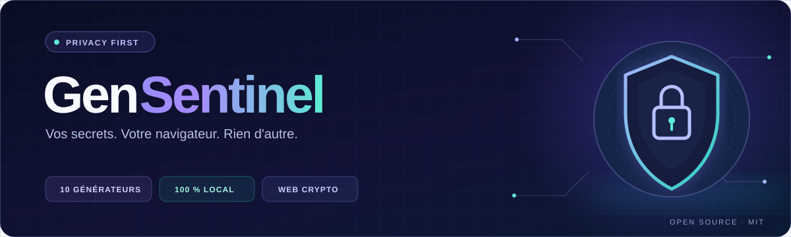
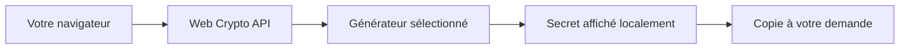

<div align="center">



<br />

[](https://nextjs.org/)
[](https://www.typescriptlang.org/)
[](https://tailwindcss.com/)
[](https://developer.mozilla.org/fr/docs/Web/API/Web_Crypto_API)
[](LICENSE)

**10 générateurs · 4 thèmes · 0 secret envoyé au serveur**

Un atelier de génération de secrets conçu pour les développeurs, les administrateurs et tous ceux qui préfèrent garder leurs clés pour eux.

[Découvrir les générateurs](#-les-10-générateurs) · [Installer](#-démarrage-rapide) · [Comprendre la sécurité](#-sécurité--confidentialité) · [Contribuer](#-contribuer)

</div>

---

## ✨ Le bon secret, au bon format

Une clé d'API, un mot de passe Wi-Fi, un UUID ou un secret JWT ? **GenSentinel** les génère directement dans votre navigateur avec l'API native **Web Crypto**. Pas de compte, pas d'interface surchargée, pas de copie vers une API distante.

| 🛡️ **Privé par conception** | ⚡ **Prêt en un clic** | 🎛️ **Personnalisable** |
| :--- | :--- | :--- |
| Génération locale, sans base de données ni analytique. | Plusieurs propositions par générateur, avec copie individuelle. | Longueur, caractères, séparateurs et préfixes selon le format. |
| **Aucune valeur générée n'est envoyée au serveur.** | Raccourci `R` pour tout régénérer. | Quatre thèmes, préférence conservée dans le navigateur. |

## 🧰 Les 10 générateurs

| Générateur | Pour quoi faire ? | Personnalisation |
| :--- | :--- | :--- |
| 🗣️ **Phrase secrète mémorisable** | Composer une phrase à partir de mots aléatoires. | 2 à 10 mots, séparateur |
| 🔐 **Mot de passe robuste** | Générer un mot de passe en garantissant les catégories sélectionnées. | 8–128 caractères, casse, chiffres, symboles |
| 🔤 **Jeton alphanumérique** | Produire un token sans caractère spécial. | 8–256 caractères |
| 🆔 **UUID v4** | Créer un identifiant aléatoire au format UUID. | Format standard, 122 bits aléatoires |
| 🔌 **Clé d'API** | Générer une valeur préfixée, de type `sk_live_…`. | Préfixe libre, 16–128 caractères aléatoires |
| #️⃣ **Clé hexadécimale** | Obtenir une chaîne d'octets aléatoires en hexadécimal. | 8–128 octets |
| 🎟️ **Secret JWT** | Produire un secret aléatoire encodé en Base64. | 16–128 octets |
| 🐍 **Clé secrète Django** | Créer une valeur compatible avec `SECRET_KEY`. | 32–128 caractères |
| 🍃 **ObjectId MongoDB** | Produire un identifiant de 12 octets en hexadécimal. | Horodatage + 8 octets aléatoires |
| 📶 **Mot de passe Wi-Fi / WPA** | Créer une clé pour un réseau sans fil. | 8–63 caractères |

> [!TIP]
> Chaque générateur est indépendant : changez ses paramètres pour obtenir immédiatement de nouvelles valeurs, ou utilisez **Tout régénérer** pour rafraîchir l'ensemble.

## 🎨 Une interface, quatre ambiances

Le même outil, avec le style qui va à votre environnement :

| ☀️ Clair | 🌙 Sombre | 💻 Terminal | 🌆 Cyberpunk |
| :---: | :---: | :---: | :---: |
| Sobre et lumineux | Confortable, contrasté | Monospace et vert phosphore | Cyan, indigo et accents néon |

Le thème suit initialement la préférence système et peut être modifié à tout moment. **Seul le choix du thème est conservé dans `localStorage`** : les secrets générés ne le sont pas.

## 🚀 Démarrage rapide

**Prérequis :** Node.js **22+** recommandé et npm.

```bash
git clone https://github.com/neosoda/GenSentinel.git
cd GenSentinel

npm ci
npm run dev
```

Ouvrez **http://localhost:3000**. C'est tout. Aucun fichier `.env`, compte ou service tiers n'est nécessaire pour lancer le projet.

<details>
<summary><strong>📦 Démarrer en mode production</strong></summary>

```bash
npm ci
npm run build
npm run start
```

Pour une utilisation publique, servez l'application en **HTTPS**, notamment pour la disponibilité des fonctionnalités modernes du presse-papiers.

</details>

<details>
<summary><strong>🧪 Scripts de qualité</strong></summary>

```bash
npm test           # Tests unitaires des primitives et générateurs
npm run typecheck  # Vérification TypeScript
npm run lint       # ESLint
npm run build      # Compilation Next.js
```

</details>

## 🔒 Sécurité & confidentialité

GenSentinel privilégie les primitives cryptographiques du navigateur, plutôt que les générateurs pseudo-aléatoires classiques.

- **Aléa cryptographique :** `crypto.getRandomValues()` et `crypto.randomUUID()` quand disponible.
- **Tirage uniforme :** échantillonnage par rejet pour éviter le biais de modulo.
- **Mots de passe :** au moins un caractère de chaque catégorie activée, suivi d'un mélange de Fisher–Yates utilisant une source cryptographique.
- **Sans collecte :** pas de connexion utilisateur, de base de données, de tracker ou d'appel d'API pour générer les valeurs.
- **Protection HTTP :** en-têtes de sécurité configurés dans Next.js (dont CSP, anti-`iframe` et `nosniff`).



> [!IMPORTANT]
> **Un générateur n'est pas un coffre-fort.** Les valeurs copiées passent par le presse-papiers de votre appareil. Pour des secrets sensibles, privilégiez une instance que vous contrôlez et une connexion HTTPS. Les estimations d'entropie affichées sont indicatives : les phrases mémorisables utilisent actuellement une liste de **330 mots** et les phrases courtes ne conviennent pas aux secrets critiques.

## 🧱 Sous le capot

| Couche | Technologie |
| :--- | :--- |
| Application | [Next.js 16](https://nextjs.org/) · App Router |
| Interface | [React 19](https://react.dev/) · [Tailwind CSS v4](https://tailwindcss.com/) |
| Code | [TypeScript](https://www.typescriptlang.org/) en mode strict |
| Génération | [Web Crypto API](https://developer.mozilla.org/fr/docs/Web/API/Web_Crypto_API) |
| Typographie | Geist · Geist Mono · JetBrains Mono · Orbitron |
| Tests | Test runner natif de Node.js |

```text
app/                  Interface et styles, App Router
components/           Carte réutilisable de générateur
lib/crypto.ts         Primitives cryptographiques
lib/generators.ts     Catalogue et configuration des 10 générateurs
lib/wordlist.ts       Dictionnaire des phrases mémorisables
tests/                Tests des primitives et formats
public/               Ressources statiques
```

**Aucun backend de génération, aucune base de données.** Next.js sert l'application ; la création des secrets s'exécute dans le navigateur.

## 🤝 Contribuer

Les corrections, améliorations d'accessibilité, nouveaux formats et retours de sécurité sont bienvenus.

1. Ouvrez une [issue](https://github.com/neosoda/GenSentinel/issues) pour proposer une évolution ou signaler un problème.
2. Créez votre branche et apportez une modification ciblée.
3. Vérifiez `npm test`, `npm run typecheck` et `npm run lint`.
4. Ouvrez une pull request en expliquant le changement.

Si vous découvrez une faiblesse touchant la génération des secrets, **évitez de publier des secrets réels ou des données sensibles dans une issue**.

## 📄 Licence

Distribué sous licence **MIT**. Voir [LICENSE](LICENSE).

---

<div align="center">

**Made with care for developers who take privacy seriously.**

[⭐ Mettre une étoile](https://github.com/neosoda/GenSentinel) · [🐛 Signaler un bug](https://github.com/neosoda/GenSentinel/issues) · [👨‍💻 neosoda](https://github.com/neosoda)

<sub>GenSentinel · Open source · MIT License</sub>

</div>
