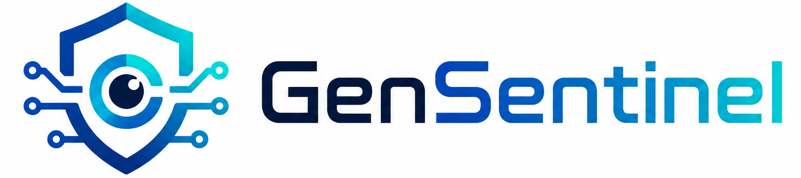

<div align="center">
  

  <br />
  <br />

  # GenSentinel

  **Générateur de clés et de secrets cryptographiques 100 % côté client.**

  [](https://nextjs.org/)
  [](https://www.typescriptlang.org/)
  [](https://tailwindcss.com/)
  [](LICENSE)
</div>

<br />

> **GenSentinel** est une application web moderne permettant aux développeurs de générer instantanément des mots de passe, des phrases secrètes, des clés d'API, des UUIDs, des secrets JWT et plus encore, de façon sécurisée et sans aucun appel serveur (grâce à l'API Web Crypto native du navigateur).

---

## ✨ Fonctionnalités Principales

- 🛡️ **Sécurité Zéro-Trust** : 100 % des clés sont générées via `crypto.getRandomValues()` avec échantillonnage par rejet sans biais de modulo et mélange de Fisher-Yates CSPRNG. Aucune clé n'est transmise sur le réseau.
- 🚀 **Performances instantanées** : Architecture propulsée par Next.js 16 (App Router) et en-têtes HTTP de sécurité stricts (CSP, `X-Frame-Options`, `X-Content-Type-Options`, `Referrer-Policy`).
- 🎨 **4 Thèmes de Travail** : Alternez dynamiquement entre 4 environnements persistés localement :
  - **Clair** & **Sombre** (Épuré, contrastes calibrés Slate & Indigo)
  - **Terminal** (Brutalisme monospace `JetBrains Mono` et accents vert phosphore)
  - **Cyberpunk** (Haut contraste structuré avec titrage `Orbitron` et valeurs `JetBrains Mono`)
- ⚙️ **Hautement Personnalisable** : Ajustez la longueur, les classes de caractères, les préfixes et les séparateurs en temps réel avec calcul exact d'entropie en bits.
- 🚫 **Zéro Tracking** : Pas d'analytique, pas de cookies, pas d'inscription.

## 🛠️ Les 10 Générateurs Inclus

* 🗣️ **Phrases secrètes mémorisables** (2 à 10 mots, séparateur personnalisable)
* 🔑 **Mot de passe robuste** (Garantie systématique de chaque classe de caractères sélectionnée + mélange CSPRNG)
* 🔤 **Jeton alphanumérique** (Lettres et chiffres sans conflit de symboles)
* 🆔 **UUID v4** (Identifiants uniques universels RFC 4122, 122 bits d'entropie)
* 🔌 **Clés d'API** (Préfixe personnalisable ex. `sk_live_` + segment aléatoire)
* 🔢 **Clé Hexadécimale** (8 à 128 octets pour clés AES/HMAC)
* 🔐 **Secret JWT** (16 à 128 octets encodés en Base64 standard)
* 🐍 **Clé secrète Django** (Alphabet compatible `settings.py`)
* 🍃 **ObjectId MongoDB** (12 octets : horodatage 4 octets + 64 bits d'aléa cryptographique)
* 📶 **Mot de passe WiFi / WPA** (Symboles compatibles routeurs, 8 à 63 caractères)

---

## 🚀 Installation, Démarrage & Vérifications

```bash
# 1. Cloner le dépôt
git clone https://github.com/neosoda/GenSentinel.git
cd GenSentinel

# 2. Installer les dépendances
npm install

# 3. Lancer le serveur de développement
npm run dev

# 4. Exécuter les contrôles de qualité
npm test
npm run typecheck
npm run lint
npm run build
```

Ouvrez ensuite [http://localhost:3000](http://localhost:3000) avec votre navigateur.

## 🏗️ Stack Technique

* **Framework** : [Next.js 16](https://nextjs.org/) (App Router, React 19)
* **Langage** : [TypeScript](https://www.typescriptlang.org/) (`strict: true`)
* **Design** : [Tailwind CSS v4](https://tailwindcss.com/) (`@theme inline` et tokens `data-theme`)
* **Polices** : *Geist*, *Geist Mono*, *JetBrains Mono*, *Orbitron* via `next/font/google`.
* **Tests** : Runner natif Node.js (`node --test`).

## 📄 Licence

Ce projet est sous licence MIT. Voir le fichier [LICENSE](LICENSE) pour plus d'informations.
